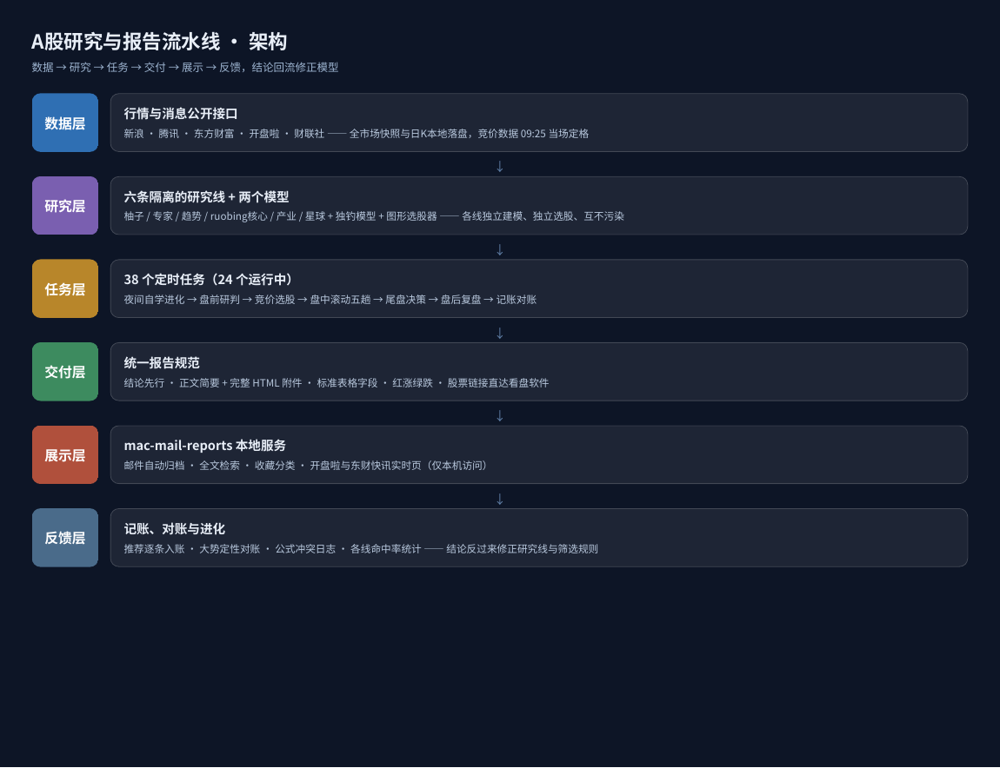
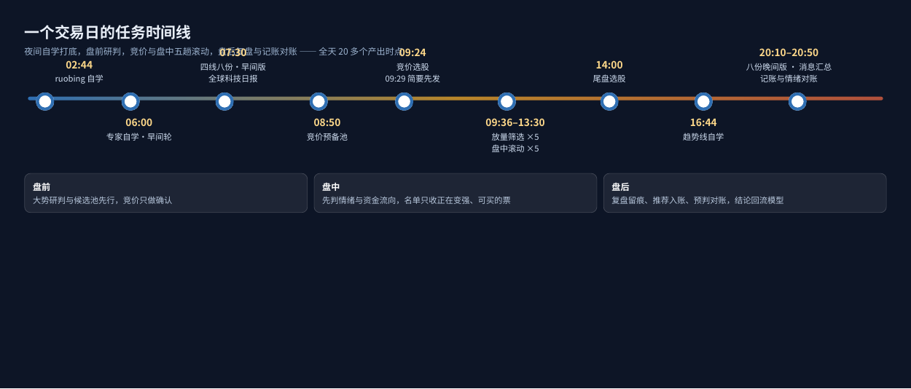
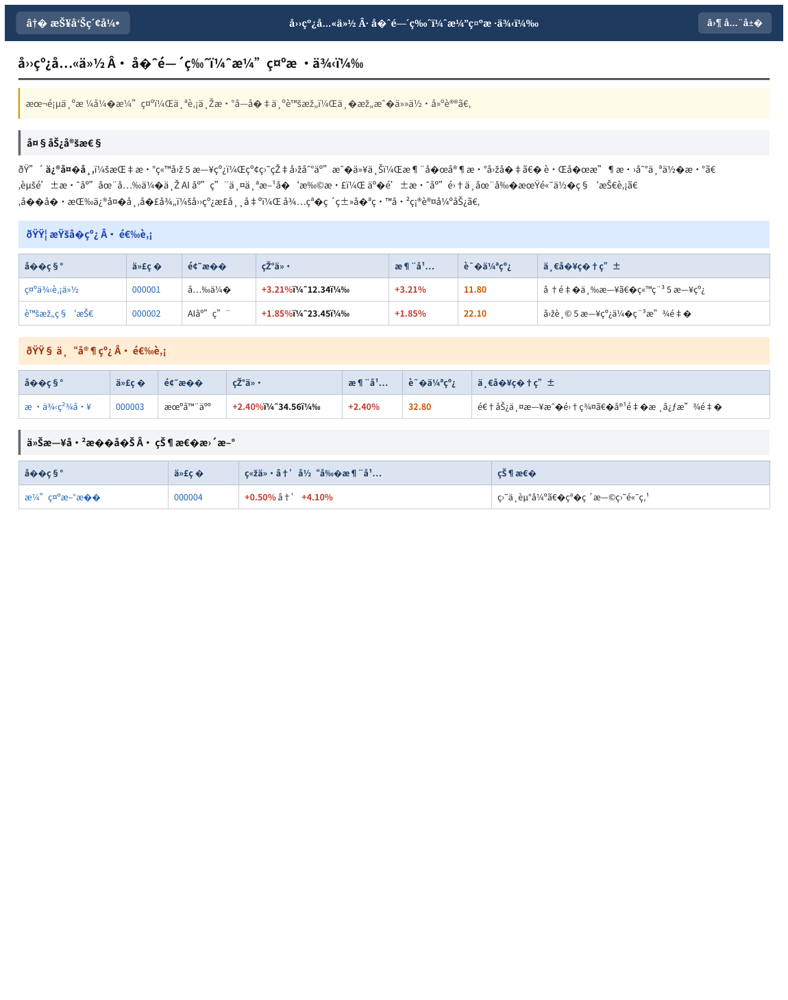
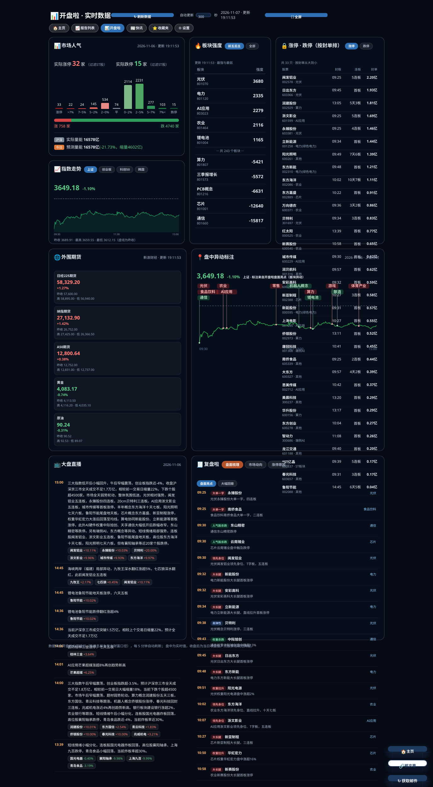

# AShare Report System · A股研究与报告流水线

一套「个人投资者 + AI」协作的 A 股研究系统：多条相互隔离的研究线全天候
运行 30 多个定时任务，覆盖盘前、竞价、盘中、盘后与夜间自学，产出标准化的
选股与复盘报告，经邮件送达，再由本地报告服务
[**mac-mail-reports**](https://github.com/tfbabi/mac-mail-reports)
归档、检索与呈现。

> 这个仓库是整套系统的「总纲」：任务矩阵、研究线说明、数据源口径、
> 交付规范与自研工具代码。mac-mail-reports 只是它的展示终端——
> 报告之所以重要，是因为背后有这套流水线在持续生产、验证和进化。

## 为什么做这套系统

市面上的复盘和荐股内容有三个通病：只有观点没有可执行动作、只报喜不报
证伪条件、从不回头对账。这套系统的第一准则与之相反：

**一切工作的目的都是帮决策者赚钱，观察和记录只是手段。**
每份报告必须落到能下手的动作——买什么、什么价位、什么条件触发、
错了在哪条线止损；每条预判都要留痕，事后用实际走势对账。

详见 [设计原则](docs/PRINCIPLES.md)。

## 系统架构

```
数据层    行情/消息公开接口（新浪·腾讯·东方财富·开盘啦·财联社…）
          全市场快照与日K本地落盘，竞价数据 09:25 当场定格
   ↓
研究层    六条相互隔离的研究线（柚子 / 专家 / 趋势 / ruobing核心 /
          产业 / 星球）+ 独钓竞价模型 + 图形选股器，各线独立建模、
          独立选股、互不污染
   ↓
任务层    38 个定时任务（24 个运行中）：自学进化 → 盘前研判 →
          竞价选股 → 盘中滚动 → 尾盘决策 → 盘后复盘 → 记账对账
   ↓
交付层    统一规范：结论先行、正文简要 + 完整 HTML 附件、
          标准表格字段、红涨绿跌着色、股票链接直达看盘软件
   ↓
展示层    mac-mail-reports 本地服务：邮件自动归档、全文检索、
          收藏分类，开盘啦/东财快讯实时页
   ↓
反馈层    推荐记账与大势定性对账、公式冲突日志、各线命中率统计，
          结论反过来修正研究线模型与筛选规则
```

## 一个交易日的样子

| 时间 | 任务 | 产出 |
| --- | --- | --- |
| 02:44 | ruobing 核心线自学 | 方法论精读 + 大势预判对账 |
| 06:00 | 专家线自学·早间轮 | 高手复盘吸收、候选方法回验 |
| 07:30 | 四线八份·早间版 | 四条线各出复盘 + 选股 |
| 07:30 | 全球科技与产业趋势日报 | 海外科技/产业动态 + 盘前消息 |
| 08:50 | 竞价预备池 | 前置计算昨日基线与候选池 |
| 09:24 | 竞价选股 | 四线竞价名单 + 深水低开提示 |
| 09:36–11:10 | 竞价放量筛选器 ×5 | 机械筛选：竞价放量异动名单 |
| 09:55–13:30 | 盘中滚动 ×5 | 情绪定性 + 四线盘中名单 |
| 11:00 | 成交放量筛选器 | 盘中放量走强名单 |
| 11:35 | 四线八份·午间版 | 上午复盘 + 下午选股 |
| 14:00 | 尾盘选股 | 四线合并尾盘名单 |
| 16:44 | 趋势线自学 | 模仿练习 + 模式补强 |
| 20:10 | 四线八份·晚间版 | 全天复盘 + 次日选股 |
| 20:30 | 晚间消息汇总 | 国内外消息面与次日影响标注 |
| 20:50 | 推荐记账与情绪周期 | 全天推荐入账、情绪定性对账 |

完整任务清单（含暂停中的任务）见 [任务矩阵](docs/TASKS.md)。

## 图文导览

**系统架构**——五层流水线加一条反馈回流：盘后记账与对账的结论，
会反过来修正研究线模型与筛选规则，系统因此是越用越准的闭环，
而不是一堆定时脚本的堆叠。



**一个交易日的时间线**——从凌晨自学到晚间对账，全天 20 多个产出
时点彼此衔接：盘前的预备池喂给竞价，竞价与盘中五趟滚动共用同一套
情绪定性，尾盘名单博弈次日，晚间八份做全天复盘。



**报告样张（虚构数据）**——每份报告先给大势定性，再按研究线分段出
名单：名称/代码/题材/现价/涨幅/证伪线/一句理由，红涨绿跌；
当天已提过的票只在文末「状态更新」表里出现，不重复占名单。



**展示层（关联项目 mac-mail-reports）**——报告经邮件送达后在本地
自动归档：导航主页、全文检索、收藏分类，以及开盘啦市场数据页
（板块强度、涨停封单、情绪分布、盘中异动标注）。




## 文档

- [设计原则](docs/PRINCIPLES.md)——赚钱导向、预期差、可买性、情绪感知、
  逆势主线、进化优先于公式
- [任务矩阵](docs/TASKS.md)——38 个定时任务的名称、时间、产出与状态
- [研究线说明](docs/RESEARCH-LINES.md)——六条研究线 + 两个模型的定位与隔离原则
- [数据源与口径](docs/DATA-SOURCES.md)——各数据源的可用性、字段口径与实测坑
- [交付规范](docs/DELIVERY-SPEC.md)——报告格式、表格标准、质量红线
- [工具代码](tools/README.md)——竞价抓取、机械筛选、盘中摘要、HTML 转换器

## 关联项目

- **展示终端**：[mac-mail-reports](https://github.com/tfbabi/mac-mail-reports)
  ——本系统报告的本地归档与阅读服务（Mac）

## 关于内容与版权

- 本仓库只包含**自研文档与工具代码**。
- 各研究线的方法论来自对公开复盘、实盘比赛与付费内容的长期学习提炼；
  第三方原文、付费内容与博主语料**不在本仓库内**，研究线文档只做
  框架级介绍，不复述他人体系细节。
- 仓库不含任何个人账户、持仓、邮箱与密钥信息。

## 免责声明

个人研究项目，记录一套 AI 协作的研究流水线设计与实现，不构成任何
投资建议。行情数据来自第三方公开接口，版权归原方所有。

## License

MIT
